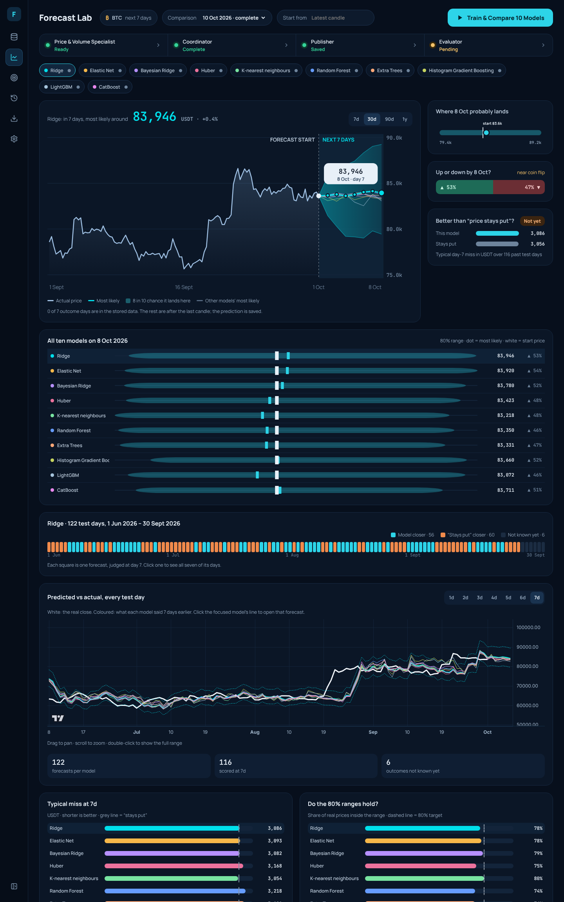

# Foresight — Cryptocurrency Historical Dataset Explorer & Multi-Specialist Forecasting Lab

**Foresight** is a local desktop historical cryptocurrency dataset explorer and numerical forecasting research platform built with **React 19, TypeScript, Vite, TradingView Lightweight Charts, FastAPI, Parquet, and SQLite**.



> **Specifications & Architecture Documentation:**
> - [Multi-Specialist Reasoning Specification v2](docs/foresight-specification.md)
> - [Multi-Agent Implementation Plan](docs/multi-agent-implementation-plan.md)
> - [Original Specification (v1 Archive)](docs/foresight-specification-v1-archived.md)
> - [Implementation Acceptance Report](docs/implementation-acceptance.md)
> - [News & Macro Implementation Acceptance](docs/news-implementation-acceptance.md)
> - [Specification Conformance Audit](docs/specification-conformance-audit.md)

---

## Key Capabilities

1. **Checksum-Verified Historical Dataset Explorer (`BTCUSDT` & `ETHUSDT`)**
   - Downloads 48 months (`2022-10-01` to `2026-10-01` UTC) of hourly spot klines directly from Binance Vision public archives.
   - Verifies every monthly `.zip` archive against its published `.CHECKSUM` (SHA-256) prior to ingestion.
   - Preserves genuine market gaps (such as the 1-hour Binance spot maintenance halt on `2023-03-24 13:00 UTC`) without synthetic interpolation or forward-filling, surfacing them as explicit quality warnings and `"1h missing"` indicators on the chart.
   - Chronological split visualization: **Training** (`Oct 2022 – Sep 2025`, 36 months, ~75%), **Validation** (`Oct 2025 – May 2026`, 8 months, ~17%), and **Final Test** (`Jun 2026 – Sep 2026`, 4 months, ~8% held out for evaluation).

2. **Multi-Family Numerical Forecasting & Model Comparison**
   - Ten registered numerical model families (comparing **Ridge**, **LightGBM**, and **K-Nearest Neighbours** by default, plus **Elastic Net**, **Bayesian Ridge**, **Huber**, **Random Forest**, **Extra Trees**, **Histogram Gradient Boosting**, and **CatBoost**).
   - **Price & Volume Specialist** computes 16 strictly causal price/volume features across configurable look-back windows (`30`, `90`, `180` days) to predict 7 daily horizon targets (`+24h` to `+168h`).
   - Empirical calibration residuals produce pointwise **80% prediction intervals** and directional rise/fall probabilities.
   - Explicit **Coordinator**, **Publisher**, and **Evaluator** pipeline stages with immutable artifact and SQLite persistence, protocol fingerprinting, and frozen vs. adaptive replay modes.

3. **Timestamped News & Numerical News & Macro Lab**
   - Dedicated **News & Macro Lab** supporting explicit collection/import, point-in-time evidence packet construction, keyword and Jev classification, feature extraction, and ablation across price-only, price+keyword, price+Jev, and standalone numerical news variants.

---

## Quick Start

Python 3.12 and Node.js/npm were used for acceptance verification. Dependencies are pinned in `requirements.txt` and `frontend/package-lock.json`.

### 1. Install & Build

```bash
python3 -m venv .venv
.venv/bin/pip install -r requirements.txt

cd frontend
npm ci
npm run build
cd ..
```

> **Note (macOS):** LightGBM requires OpenMP (`brew install libomp`) before running comparisons that include the `lightgbm` family.

### 2. Run Production Server

```bash
.venv/bin/uvicorn backend.app.main:app --host 127.0.0.1 --port 8000
```

- **Application UI:** `http://127.0.0.1:8000`
- **OpenAPI Documentation:** `http://127.0.0.1:8000/docs`

### 3. Run in Development Mode (Hot Reload)

Start the FastAPI backend on port `8000` and the Vite dev server on port `5173` (which proxies `/api` to `127.0.0.1:8000`):

```bash
# Terminal 1 — Backend
.venv/bin/uvicorn backend.app.main:app --host 127.0.0.1 --port 8000

# Terminal 2 — Frontend
cd frontend
npm run dev -- --host 127.0.0.1 --port 5173
```

Open `http://127.0.0.1:5173`. Use a single backend worker process: job workers run in local threads with durable SQLite job reservations and restart recovery.

---

## Desktop Workflow

1. **Dataset → Import Data:** Download or reuse checksum-verified Binance monthly archives, validate OHLCV invariants, and atomically publish a dataset bundle. `BTCUSDT` and `ETHUSDT` are available in the explorer; forecasting targets `BTCUSDT`. Missing candles remain uninterpolated gaps and quality warnings.
2. **Forecast Lab → Train & Compare:** Trains the configured model families (default: Ridge, LightGBM, and KNN), scores each against the no-change baseline on the validation window, and selects the lowest 7-day MAE winner. Only the winning model is backtested on the final test split and generates the next 7-day forecast. The full validation table is saved on the run as `validation_selection`. Additional families can be configured via `FORESIGHT_COMPARISON_FAMILIES` (comma-separated family IDs) or passed as `families` to the API/CLI.
3. **Interactive Six-Tab Forecast Lab:** Displays the validation-selected model by default. In-chart controls toggle the primary model, additional saved models, actual prices, historical range, and 80% uncertainty ribbons. Leaving the UTC origin blank uses the latest completed candle in stored data.
4. **Historical Accuracy & Horizon Evaluation:** Compares daily predictions against realized prices at matching target dates across 1-to-7-day horizons (`+24h` to `+168h`). Click any origin point to inspect all 7 targets. Matured outcomes are scored automatically; future outcomes are explicitly counted as pending.
5. **Error, Coverage & Evidence Inspection:** Compare model MAE, interval coverage, directional accuracy, and Brier scores against the naive no-change baseline, and inspect complete point-in-time evidence packets (`forecast-evidence/1`) in the **Evidence & Reasoning** tab or the **Inspect** drawer.
6. **One Run at a Time Policy:** When a price training run (`Train & Compare`, `Train & Predict`, or CLI/API replay) completes, it replaces the previous price run for that market while preserving experimental News & Macro models. Cancelled or failed runs clean up only their partial artifacts, leaving the prior valid run intact.

---

## Forecast Protocol

- **Chronological Splits (UTC Half-Open Intervals):**
  - **Training:** `2022-10-01 00:00:00` → `2025-10-01 00:00:00` (36 months)
  - **Validation:** `2025-10-01 00:00:00` → `2026-06-01 00:00:00` (8 months; subdivided into `Oct–Feb` model selection and `Feb–Jun` residual calibration)
  - **Final Test:** `2026-06-01 00:00:00` → `2026-10-01 00:00:00` (4 months)
  - Configurable via `FORESIGHT_START`, `FORESIGHT_TRAIN_END`, `FORESIGHT_VALIDATION_END`, and `FORESIGHT_END` before importing/training.
- **Target Alignment:** Origin price is the exact hourly candle closing at the forecast origin. Seven targets correspond to exact closes at `+24, +48, …, +168` hours. Incomplete feature windows are excluded, never filled.
- **Frozen vs. Adaptive Replay:**
  - *Frozen replay* holds the validation-selected model fixed across the test window.
  - *Adaptive replay* evaluates retraining every 30 days using a strict 45-day look-back cutoff and requires $\ge 1\%$ MAE improvement, no worse MAE than no-change, no worse interval score than incumbent/baseline, and coverage $\ge 70\%$ for promotion.
  - A cryptographic protocol fingerprint tracks look-backs, penalty grids, feature definitions, split boundaries, and function source code; any run using final-test outcomes carries an explicit `uses_final_test_outcomes` flag.

---

## Project Structure & Storage

```text
├── backend/
│   └── app/
│       ├── api/            # FastAPI HTTP routers (datasets, import jobs, forecasting, news)
│       ├── forecasting/    # Feature engineering, model families, coordinator, publisher, evaluator
│       ├── markets/        # Pluggable market & data source registry (BTCUSDT, ETHUSDT)
│       └── news/           # Timestamped news ingestion, packets, keyword/Jev classifiers
├── cli/
│   ├── foresight_cli.py    # Dataset & forecasting CLI
│   └── news_cli.py         # News & Macro Lab CLI
├── frontend/
│   └── src/                # React 19 + TypeScript + TradingView Lightweight Charts UI
├── data/
│   ├── raw/                # Original Binance .zip archives, .CHECKSUM files & raw news
│   ├── manifests/          # SHA-256 verification manifests
│   ├── bundles/            # Atomic dataset, quality & manifest bundles
│   ├── processed/          # Active Parquet datasets & relative bundle pointers
│   ├── versions/           # Immutable SHA-256 forecasting dataset snapshots
│   ├── models/             # Serialized model metadata & checksum-verified estimator artifacts
│   └── evidence/           # Point-in-time news & market evidence packets
├── docs/                   # Specifications, implementation plans & acceptance audits
├── screenshots/            # Desktop, tablet & mobile verification screenshots
└── tests/                  # Pytest unit, integration & conformance test suite
```

---

## Command-Line Interface (CLI)

### Dataset & Forecasting CLI (`cli/foresight_cli.py`)

```bash
# Dataset ingestion, inspection & export
.venv/bin/python cli/foresight_cli.py import --symbol BTCUSDT
.venv/bin/python cli/foresight_cli.py inspect --symbol BTCUSDT
.venv/bin/python cli/foresight_cli.py export --symbol BTCUSDT --split final_test --out test.csv

# Training, multi-model comparison & backtesting
.venv/bin/python cli/foresight_cli.py train-backtest --mode frozen
.venv/bin/python cli/foresight_cli.py train-backtest --mode adaptive
.venv/bin/python cli/foresight_cli.py train-backtest --mode frozen --lookbacks 30 90 --alphas 10 100
.venv/bin/python cli/foresight_cli.py compare
.venv/bin/python cli/foresight_cli.py compare --families direct-ridge-log-return lightgbm knn catboost

# Inspection, prediction, evaluation & model lifecycle
.venv/bin/python cli/foresight_cli.py runs
.venv/bin/python cli/foresight_cli.py models
.venv/bin/python cli/foresight_cli.py agents --forecast FORECAST_ID
.venv/bin/python cli/foresight_cli.py predict --origin 2026-06-01T00:00:00Z --model MODEL_ID
.venv/bin/python cli/foresight_cli.py history --mode frozen --page 1
.venv/bin/python cli/foresight_cli.py evaluate --forecast FORECAST_ID --clock 2026-06-08T00:00:00Z
.venv/bin/python cli/foresight_cli.py metrics --run RUN_ID
.venv/bin/python cli/foresight_cli.py retrain --model MODEL_ID --cutoff 2026-09-30T00:00:00Z
.venv/bin/python cli/foresight_cli.py rollback --model MODEL_ID
```

### News & Macro CLI (`cli/news_cli.py`)

OpenAI news extraction is available alongside keywords and Jev. The same provider
is available in **News & Macro Lab → Classification experiment → OpenAI**.
It uses the Responses API with strict structured outputs and the pinned
`gpt-4o-mini-2024-07-18` snapshot. See [OpenAI setup](docs/openai-news-setup.md).

The server and CLI automatically read the project `.env` without overriding
exported environment variables. `.env` is ignored by Git. API keys stay on the
server; ChatGPT subscription usage does not supply API credits or authentication.
Paid calls require both an API key and explicit spending configuration. New
forecast experiments also offer `price_openai` and `news_openai`, using saved
classifications only. Historical news coverage is still required for real training.

Optional Jev classifier configuration (the keyword comparator works offline without credentials):

```bash
export TYPESAFE_API_KEY="your-server-key"
export FORESIGHT_JEV_ENABLED=1
export FORESIGHT_JEV_MODEL=jev-1.13.0
```

```bash
.venv/bin/python cli/news_cli.py status
.venv/bin/python cli/news_cli.py collect --source federal-reserve
.venv/bin/python cli/news_cli.py import permitted-news.jsonl --provider archive-provider
.venv/bin/python cli/news_cli.py packet --symbol BTCUSDT --origin 2026-10-11T12:00:00Z
.venv/bin/python cli/news_cli.py preview PACKET_ID --classifier keywords
.venv/bin/python cli/news_cli.py classify PACKET_ID --classifier keywords
.venv/bin/python cli/news_cli.py features PACKET_ID --classifier keywords
.venv/bin/python cli/news_cli.py label human-label.json
.venv/bin/python cli/news_cli.py evaluate PACKET_ID
.venv/bin/python cli/news_cli.py train --symbol BTCUSDT
.venv/bin/python cli/news_cli.py predict MODEL_ID
```

---

## Testing & Verification

```bash
# Run full backend & conformance test suite (117 tests)
PYTHONDONTWRITEBYTECODE=1 .venv/bin/python -m pytest -p no:cacheprovider tests -q

# Verify frontend TypeScript compilation, production bundle & lint
cd frontend
npm run build
npm run lint
```

- **Test Status:** 117 passed tests across dataset integrity, chronological splits, multi-model comparison, replay determinism, evidence schemas, and News & Macro workflows.
- **Dataset Integrity:** `BTCUSDT` and `ETHUSDT` contain `35,063` of `35,064` expected hourly candles (`99.997%` completeness), with the single historical Binance maintenance hour (`2023-03-24 13:00 UTC`) preserved and surfaced without artificial filling.
