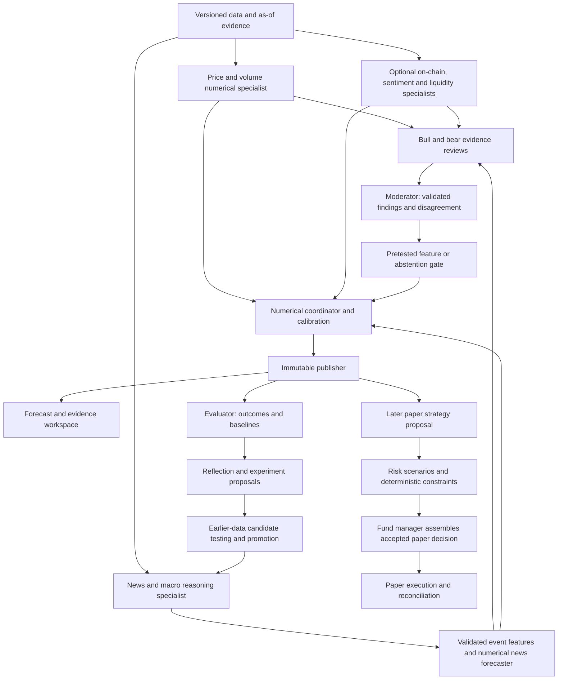

# Foresight — Revised multi-agent implementation plan

Updated 11 October 2026. Design only: no application changes, purchases, AI integrations or trading activation are authorized by this document. Target requirements are in [specification v2](foresight-specification.md); the [v1 specification](foresight-specification-v1-archived.md) and earlier audits remain historical records.

## Intended outcome

Produce evidence-grounded Bitcoin forecasts for the next seven days. Specialists extract different information; researchers challenge it; numerical models and a calibrated coordinator turn accepted signals into predictions. An evaluator determines whether each addition improves unseen predictions. Paper strategy and hard risk controls come later and have separate after-cost acceptance criteria.

## Architecture

The Orchestrator schedules this workflow. The diagram's feedback applies only to eligible future candidate versions; it never rewrites a frozen model, historical evidence or saved forecast. Moderator-to-coordinator influence is disabled until a defined numerical gate passes an ablation. Live execution is outside scope.

## Phase 1 — Freeze the baseline and contracts

- Inspect current code and configuration again before implementation; recent changes may differ from older acceptance reports.
- Preserve existing raw market archives, bundles, snapshot pointers, model artifacts, SQLite records and tests. Do not relocate data merely to reorganise names.
- Record active numerical candidate families, fitting/selection/calibration periods, forecast cadence and frozen/adaptive policy in an experiment manifest.
- Define typed evidence, extraction, specialist forecast, research report, ensemble, memory candidate and paper-decision contracts. Define permitted tools and deterministic validations for each role.
- Set research budgets, deadlines, model/provider revision policy and acceptance thresholds before results are inspected. Provider, subscription and model choice remain unresolved configuration decisions.

**Exit:** repeatable numerical reference with exact timestamps and immutable outputs; documented schemas and acceptance policy. Already-inspected June–September results are labelled development.

## Phase 2 — Establish a usable news archive

- Sample historical Bitcoin coverage from archive candidates; compare original text, source quality, publication/first-seen times, revision availability and usage rights.
- Match October 2022–September 2025 for training, October 2025–May 2026 for validation, and June–September 2026 for exploratory historical testing.
- Build deterministic collectors and canonical article/event storage with hashes, manifests, versions, duplicate-event clusters and as-of filtering.
- Keep missing evidence distinct from zero sentiment and confirmed absence of relevant news. Keep newer article revisions separate.
- Create point-in-time evidence packets and a coverage report. Do not label historic publication dates as verified first-seen timestamps without support.

**Exit:** source-audited archive and reproducible evidence packets; later edits and late arrivals cannot enter earlier origins. If historical fidelity is inadequate, use forward collection for confirmation rather than manufacturing a clean archive.

## Phase 3 — Add News & Macro reasoning and forecasting

- Add a provider-neutral extraction interface and bounded, schema-validated news agent.
- Extract asset relevance, event type, novelty, realised versus announced events, sentiment, uncertainty and supporting source spans.
- Validate claims and compute aggregate features using deterministic code. Exclude unsupported extraction; persist the original provider response and validated result.
- Train and calibrate a numerical news forecaster. Also test a price-plus-news augmented model.
- Compare deterministic keywords/features with LLM extraction on identical origins. A more fluent report is not a forecasting improvement.

**Exit:** genuine second specialist and measured marginal information; no unsourced prices/probabilities, fake news or unlabelled future knowledge. Unhelpful variants remain experimental.

## Phase 4 — Combine specialists numerically

- Generate development-only out-of-fold specialist predictions and compare equal weights, learned non-negative weights, augmented model and best individual specialist.
- Combine predictive distributions; derive and independently recalibrate medians, pointwise intervals and direction probabilities.
- Freeze accepted ensemble settings and pretest price-only fallback, unavailable specialists and conflicting outputs.
- Evaluate matched origins, error correlation, overlap-adjusted uncertainty, calibration, cost and latency.

**Exit:** complete linked individual and coordinated forecasts. Promotion requires the specification's predeclared gates; otherwise retain the numerical incumbent and report no improvement.

## Phase 5 — Add bounded multi-reasoning reviews

- Add Bull and Bear independent evidence reviews, up to two rebuttal rounds and a moderator/evidence checker.
- Require source-grounded hypotheses, counterarguments and explicit uncertainty. No forced consensus or mandatory trade.
- Initially display findings without changing numerical predictions. To affect forecasts, introduce a declared feature/gate learned before evaluation.
- Compare no review, one reviewer and the debate team under identical budgets and evidence. Include failed reviews, fallbacks and abstentions in results.

**Exit:** auditably grounded reasoning and measured usefulness. If debate improves neither accuracy nor a predeclared operational measure, keep it optional or remove its forecast influence.

## Phase 6 — Controlled reflection and optional specialists

- Create time-scoped factual memory, performance summaries and a hypothesis registry.
- Low-level reflection links earlier evidence with matured errors; high-level reflection proposes changes to prompts/features/policies. Claims of causation require separate evidence.
- An Experiment agent runs allowlisted offline tools to test candidates; it cannot edit the active app or promote itself.
- Compare reflection off/on and fixed/scheduled-adaptive policies. Version prompts, schemas, memory retrieval and promoted candidates; support rollback.
- Add on-chain fundamentals, social sentiment, derivatives/liquidity and multimodal inputs individually, only after proving point-in-time data quality and marginal usefulness.

**Exit:** controlled adaptation with no future-memory leakage or silent self-modification. Current final-test outcomes cannot become a repeatedly reused untouched confirmation set.

## Phase 7 — Implement the desktop reasoning workspace

- Use one remaining-height workspace with tabs: Next 7 Days, Predicted vs Actual, Past Test Days, Accuracy & Ranges, All Numbers, Evidence & Reasoning.
- Put Models/Specialists selection inside each graph; blue primary prediction, white actual price, optional additional lines and uncertainty. Preserve selections across tabs.
- Display source/time evidence, supported findings, opposing arguments, unresolved conflicts, version information and measured model results. Label planned/experimental/bypassed roles truthfully.
- Preserve saved forecast drill-down, history range, pan/zoom, export, useful errors and agent Inspect. Separate data availability, prediction uncertainty and trade eligibility.

**Exit:** desktop screenshots and user workflows verified against real artifacts; graph sizes fill their allocated space and captions match stored targets. Deliver no mockups. This phase may be built in parallel with new backend features only when actual contracts exist; never invent successful agents to fill the UI.

## Phase 8 — Fresh confirmation and optional paper trading

- Freeze the selected pipeline before collecting untouched future outcomes. Modern LLM historical memorisation is a documented limitation; forward evaluation is the strongest confirmation here.
- Measure prediction errors and uncertainty separately from any paper strategy.
- For paper trading, define capital, venue, position/exposure limits, fees, spread, slippage, latency, CVaR/scenario assumptions, drawdown gates and order lifecycle before simulation.
- Add Trader, risk-persona reviews, deterministic risk veto, Fund Manager and paper-only adapter. Test stale evidence, outages, duplicates, rejected proposals, gaps and reconciliation.
- Compare after-cost results against predeclared strategies, including no trade and an appropriate passive benchmark. Do not infer profitable trading from forecast accuracy alone.

**Exit:** untouched predictive evidence and, separately, complete after-cost paper-risk evidence. No exchange credentials or real orders are enabled by this plan.

## Verification required across phases

Preserve existing timestamp, chronological boundary, exact-target, immutable forecast and idempotency checks. Add meaningful tests for revised article versions, as-of memory, overlapping target eligibility, source injection resistance, unsupported claims, schema failure, numerical recomputation, distribution combination, independent calibration, frozen prompts/configuration, timeout/cancellation, missing-specialist fallback and risk-veto enforcement. Run relevant Python tests, frontend build/lint and desktop browser workflows when code is eventually changed. Restart and verify service health and saved records after implementation, not for this documentation-only revision.

The completion report must show implemented/remaining roles, compared variants, sample counts, error/calibration changes, latency/cost, failed or unavailable origins, development versus untouched evidence, and any failure to beat the baseline. No claim of higher intelligence, high confidence or improved returns substitutes for these measurements.
