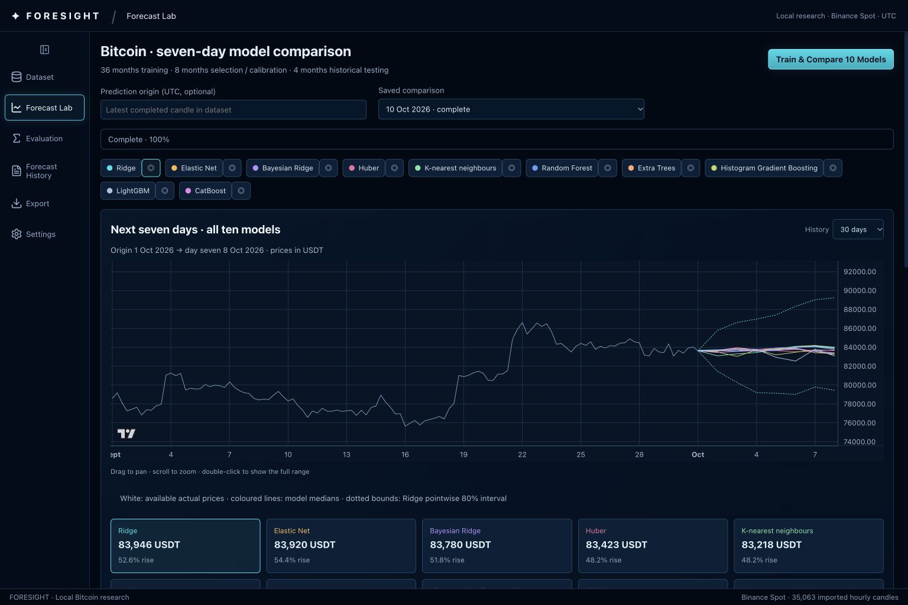
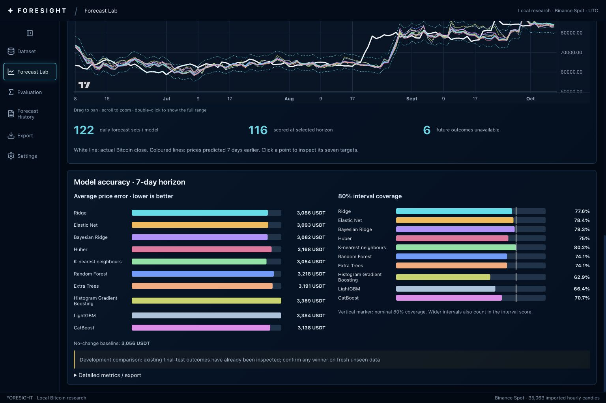

# Visual model comparison acceptance

Implemented 11 October 2026 (local time). Desktop scope; real training and saved data, no mock fallback.

Forecast Lab now offers one ten-family training action, an overlay of all ten seven-day predictions, a target-aligned historical prediction-versus-actual graph, horizon selection, visual error and coverage bars, and seven-target drill-down. The redundant selected-model dropdown and main-screen replay clock/manual-scoring workflow are removed. Older predictions remain accessible in Evaluation and Forecast History; Settings rollback remains available. History 7/30/90/180/365 changes the displayed past span, not training. Future chart whitespace preserves calendar spacing without inventing prices.

All families share the immutable snapshot, 36-month training, chronological eight-month selection/calibration and four-month frozen historical test. Lookbacks are chosen on validation; fixed family settings are not tuned on test. The test period has already been inspected, so this is explicitly development comparison, not proof from an untouched test. There is no automatic winner promotion.

## Three-family comparison (11 October 2026)

The ten families could not be told apart on this data, so Train & Compare now trains three genuinely different ones by default: Ridge (linear), LightGBM (boosted trees) and K-nearest neighbours (local analogues), plus the no-change baseline. The list comes from `COMPARISON_FAMILIES` in `backend/app/config.py` (env `FORESIGHT_COMPARISON_FAMILIES`); the other seven families remain registered and can be re-enabled without code changes.

Selection no longer looks at final test. Each family is scored on the later validation window (February to May 2026 origins, targets maturing before final test starts), which no family fitted on or chose its look-back on. The lowest seven-day price MAE wins. Only that winner is backtested on final test and publishes forecasts; the others are saved as models but produce no final-test forecasts. The run stores the full validation table in `validation_selection`, and `models` lists only the final-tested winner, so existing clients see one model. Old ten-model runs, models and reports are untouched.

CLI run `eaad3d6c4a1b4df1b0014080aa0d21e1` on dataset snapshot `50e0fd47…`, 114 shared validation origins:

| Family | Look-back | Validation seven-day MAE USDT | vs no-change |
|---|---:|---:|---:|
| Ridge (winner) | 30 days | 2860.34 | 5.8% worse |
| K-nearest neighbours | 30 days | 2908.73 | 7.6% worse |
| LightGBM | 30 days | 2955.05 | 9.4% worse |
| No-change baseline | | 2702.47 | |

Ridge was final-tested once: seven-day MAE 3086.15 USDT over 116 outcomes (95% block bootstrap 2000 to 4362), against 3056.01 for no-change, with 77.6% interval coverage. No family beats no-change on validation and the winner does not beat it on final test either, so improved accuracy is still not demonstrated. K-nearest neighbours, which looked best on final test in the ten-model run, would not have been chosen on validation. The final-test label stays development because earlier runs inspected those outcomes.

## Ten-model run (historical)

Saved comparison `dfc1ee1eae5143bfa99f358b39355f6e`, status complete. All ten families completed, each publishing 122 daily seven-day forecast sets from 1 June through 30 September 2026. Each has 122 scored one-day outcomes and 116 scored seven-day outcomes; the last six seven-day targets lie beyond the dataset. The forecast origin is 1 October 2026 and seven future targets run through 8 October. Their outcomes are unavailable in the stored snapshot. Scores are automatically computed only from available exact target closes.

| Family | Seven-day price MAE USDT | 80% interval coverage |
|---|---:|---:|
| Ridge | 3086.15 | 77.6% |
| Elastic Net | 3093.38 | 78.4% |
| Bayesian Ridge | 3082.20 | 79.3% |
| Huber | 3168.14 | 75.0% |
| K-nearest neighbours | 3053.79 | 80.2% |
| Random Forest | 3218.20 | 74.1% |
| Extra Trees | 3191.16 | 74.1% |
| Histogram Gradient Boosting | 3389.43 | 62.9% |
| LightGBM | 3384.20 | 66.4% |
| CatBoost | 3137.63 | 70.7% |

The no-change seven-day baseline MAE is 3056.01 USDT. K-nearest neighbours has the lowest measured MAE here, but the difference from baseline is only about 2.22 USDT; no reliable superiority is established. Fresh unseen outcomes are required for confirmation.

## Verification

- 68 Python tests passed, including all ten real estimator families, seven-output shape/finite predictions, model checksum rejection, non-ridge immunity to final-test mutation, and exact-date visual evidence with unavailable future prices. One existing upstream Starlette/httpx deprecation warning remains.
- Production frontend build and lint passed.
- Browser: all ten lines rendered; 365-day history displayed the full year; interval model selection changed the focused bounds; one-day horizon showed 122 scored outcomes and seven-day showed 116; clicking the historical graph opened real seven-target outcomes; JSON export downloaded the correct run with ten curves.
- Backend restarted on port 8000, health confirmed, and saved comparison plus all ten models retained. Forecast-detail API returns model metadata without downloading estimator blobs.

## Screenshots

## Runtime

Dependencies pinned in requirements.txt. macOS LightGBM requires Homebrew libomp (installed for this acceptance). Estimator artifacts are local checksum-verified joblib blobs; the checksum detects corruption and does not make untrusted pickle content safe. No artifact upload endpoint exists. Comparison runs use frozen models; the older adaptive replay workflow remains separate. Saved forecast quality is research evidence, not established trading profitability.
